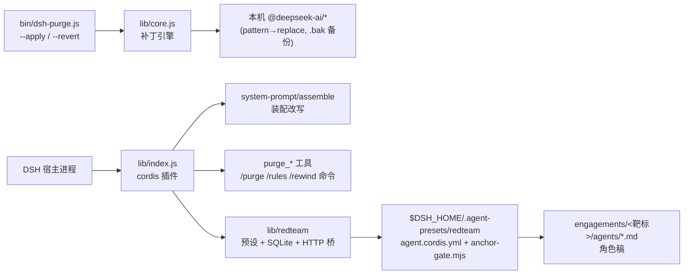
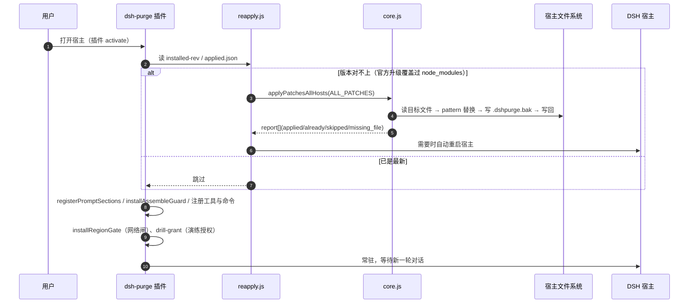
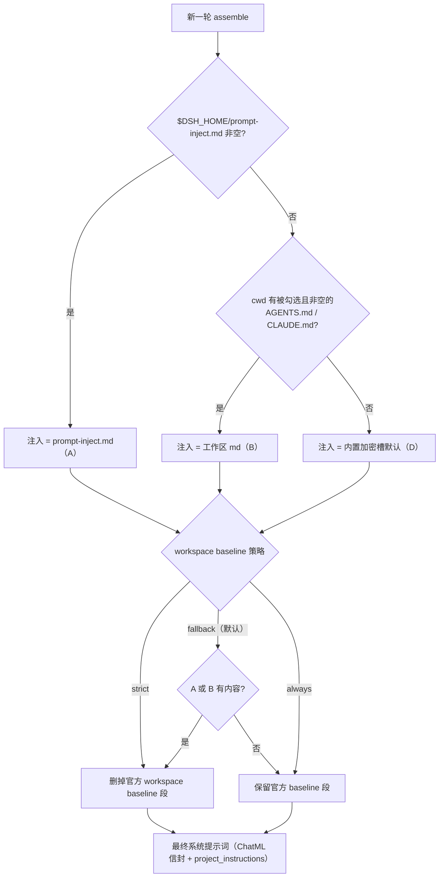
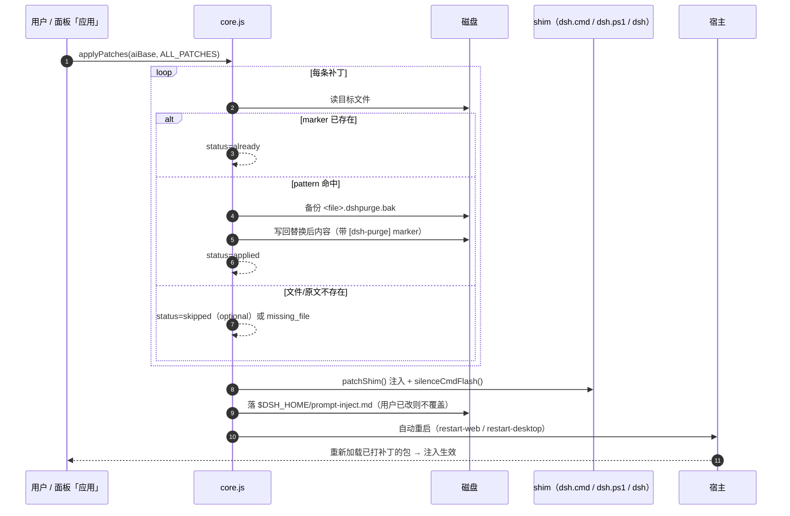

# dsh-purge 时序图：装配 / 注入 / 基线

> 配套文档：[dsh-purge-分析文档.md](dsh-purge-分析文档.md)、[dsh-purge-补丁对照表.csv](dsh-purge-补丁对照表.csv)
> 代码依据：`lib/identity.js`（`installAssembleGuard` 818-929、`rewritePromptAssembly` 931-1019）、`lib/index.js`（`registerPromptSections` 385-430）、`lib/rules.js`（`WORKSPACE_POLICIES`）、`presets/redteam/anchor-gate.mjs`

---

## 图 0 · 全景：三条路径



---

## 图 1 · 启动与应用补丁



---

## 图 2 · 每一轮的系统提示词装配（核心）

```mermaid
sequenceDiagram
  autonumber
  participant AL as agent-loop
  participant SP as systemPrompt（被 guard 包装后的 assemble）
  participant RW as rewritePromptAssembly
  participant SRC as 注入来源
  participant LLM as 模型请求

  AL->>SP: assemble(session / agent 上下文)
  SP->>SP: 原生 assemble()，抛错则返回空 sections（fail-safe）
  SP->>RW: rewrite(assembled, context)

  RW->>RW: 1. 归一化选项：dropMnemon / dropWorkspaceBaseline（按 rules 策略）
  RW->>RW: 2. 过滤 sections：丢弃 harness:identity、dsh-purge:identity、<br/>可选 mnemon 段、可选 workspace baseline 段
  RW->>RW: 3. 非插件段：stripChatmlTags + stripHarnessPersona
  RW->>RW: 4. 拆成 rest[]（官方段）与 purge[]（插件段）

  RW->>SRC: 5. 取注入正文（collectInjectText）
  SRC-->>RW: A) $DSH_HOME/prompt-inject.md<br/>B) cwd 勾选的 AGENTS.md / CLAUDE.md<br/>D) 内置加密槽默认

  RW->>RW: 6. modePromptText（标准 / 红队 / minimal 版本）<br/>adaptInjectForMinimalPreset → peelChatmlEnvelope → escapeDshInterpolation
  RW->>RW: 7. capabilityProtocolText（官方 / 红队指挥 / 红队执行三版）

  alt 红队会话
    RW->>RW: insertCardSection（身份卡 WHO YOU ARE…）
    RW->>RW: insertRoleSection（agents/&lt;code&gt;.md 角色稿）
  else 普通会话
    RW->>RW: withoutRedteamPreset（剔除红队专属段）
  end

  RW->>RW: 8. leadWithInject(sections, injectText, protocol)<br/>→ sanitizeAssemblySections → overlayOfficialIdentity
  RW->>RW: 9. 兜底：若最终 sections 里找不到 inject 前 80 字符，<br/>强制插入 name=dsh-purge / order=-100000 的段
  RW->>RW: 10. sanitizeCwdTokens（{{cwd}} / [cwd] 按宿主版本替换）
  RW-->>SP: 新 assembled（不原地改）
  SP-->>AL: 返回给 agent-loop
  AL->>LLM: 渲染系统提示词 → 发起模型请求
```

### 同一张图的 ASCII 版（不支持 mermaid 的查看器）

```
agent-loop
  └─ systemPrompt.assemble()            ← installAssembleGuard 用 defineProperty 包住
       ├─ 原生 assemble()               ← 抛错 → 返回 {sections:[],contexts:[],tools:[]}
       └─ rewritePromptAssembly()
            ① 读 options：dropMnemon / dropWorkspaceBaseline
            ② 过 sections：丢 harness:identity、dsh-purge:identity、mnemon、workspace baseline
            ③ 剩余官方段：stripChatmlTags + stripHarnessPersona
            ④ 分拣 rest[] / purge[]
            ⑤ 选注入正文：
                 A  $DSH_HOME/prompt-inject.md
                 B  cwd 勾选的 AGENTS.md / CLAUDE.md
                 D  内置加密槽默认
            ⑥ modePromptText → adaptInjectForMinimalPreset → peelChatmlEnvelope
               → escapeDshInterpolation（非法 {{x}} 拆成 { {x}}）
            ⑦ capabilityProtocolText（官方/红队指挥/红队执行）
            ⑧ 红队？insertCardSection + insertRoleSection(agents/<code>.md)
               普通？withoutRedteamPreset
            ⑨ leadWithInject → sanitizeAssemblySections → overlayOfficialIdentity
            ⑩ 兜底：找不到 inject 前 80 字符 → 强制插 order=-100000 的 dsh-purge 段
            ⑪ sanitizeCwdTokens：{{cwd}} / [cwd]
       └─ 返回新 assembled（宿主对象不被污染）
  └─ renderPrompt（补丁 #66 对 undefined text 兜底）
       └─ LLM 请求
```

---

## 图 3 · 注入正文怎么选（A / B / D + 基线策略）



状态落盘：

| 状态 | 文件 |
| --- | --- |
| 规则集正文 | `$DSH_HOME/rules/<id>.md`（≤256 KB） |
| 规则集启用状态 | `$DSH_HOME/rules/state.json` |
| cwd → 注入文件勾选 | `$DSH_HOME/dsh-purge/cwd-selections.json` |
| workspace baseline 策略 | `$DSH_HOME/dsh-purge/workspace-policy.json` |
| 当前注入正文 | `$DSH_HOME/prompt-inject.md` |

---

## 图 4 · 红队会话：装配 + 角色稿 + 锚点门

```mermaid
sequenceDiagram
  autonumber
  participant L as 红队指挥会话（preset=redteam）
  participant SUB as 执行子会话（redteamRole=xxx）
  participant AG as anchor-gate.mjs
  participant RS as role-section.js
  participant ST as redteam store（SQLite）

  L->>ST: redteam_preflight / engagement_open / agent_slot
  L->>SUB: subagent(prompt 第一行 `redteamRole: recon|assess|vuln-scan|exploit|internal`)
  SUB->>RS: agent/inbox/claimed 事件
  RS->>RS: 解析角色 → roleBySession 记忆（session 事件兜底）
  SUB->>RS: 组装系统提示词时 resolveSubagentRoleText()
  RS->>RS: 读 engagements/&lt;当前靶标&gt;/agents/&lt;code&gt;.md
  RS-->>SUB: 角色稿文本插入提示词（清洗稿与运行环境前提之间）

  SUB->>AG: agent/request（每步）
  AG->>AG: 首段 reasoning 判定：有 we、无 let me → 锚住
  alt 未锚住 / 步数 < maxBootstrapSteps
    AG-->>SUB: maxTokens = bootstrapMaxTokens（preset 8192）
  else 已锚住 / 步数够了
    AG-->>SUB: 去掉 maxTokens，放开输出
  end
  SUB->>AG: compaction/end
  AG->>AG: resetToControlled()（下一轮重新收紧）

  SUB->>ST: redteam_asset_add / vuln_add / shot_add / evidence_record
  L->>ST: evidence_verify / score_list / report
```

补充：`anchor-gate` 放开后还会把官方的 `<agent_instructions>` 消息替换成一条 `<system-reminder>`，只点名文件路径（`instructionHint`），避免整篇工作区说明长期占上下文。

---

## 图 5 · 一次 `--apply` 的文件级时序



---

## 关键点速记

1. **装配是"替换"不是"追加"**：`rewritePromptAssembly` 返回全新 `assembled`，官方段会被清洗（去 ChatML、去 Harness persona）、基线按策略删除。
2. **注入一定在**：哪怕前面的段落都被过滤，最后还有"前 80 字符兜底"强制插入 `order=-100000` 的 `dsh-purge` 段。
3. **失败不致命**：原生 assemble 抛错 → 空 sections；rewrite 抛错 → 原样返回；shim 缺失 → 跳过；补丁不匹配 → `skipped`。
4. **红队是"双层人格"**：preset 的 `persona.prefix`（指挥手册）常驻，执行角色的 `agents/<code>.md` 按 `redteamRole:` 首行动态插入。
5. **锚点门只管两件事**：bootstrap 阶段压 `maxTokens`、放开后把工作区说明换成路径提示；不裁工具、不换人设。
